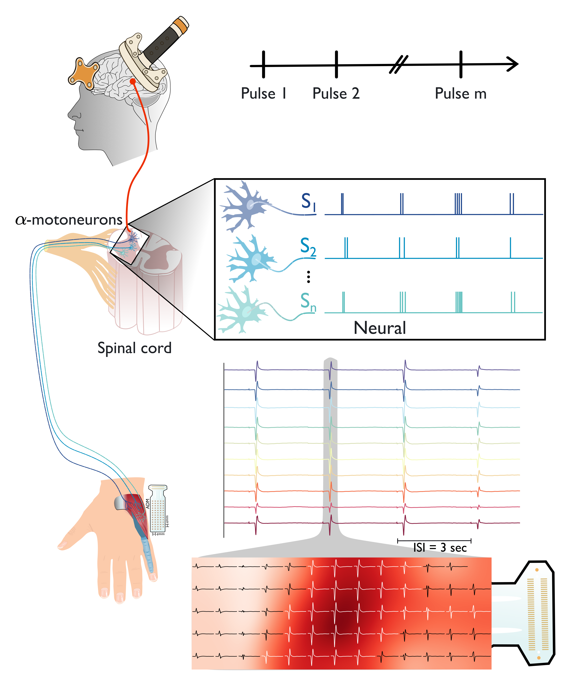
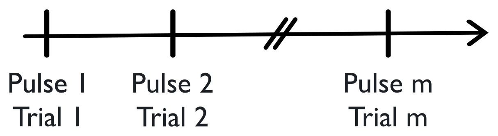
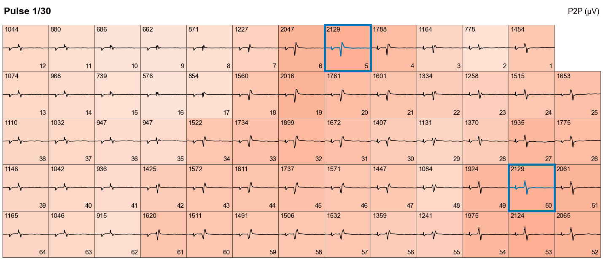
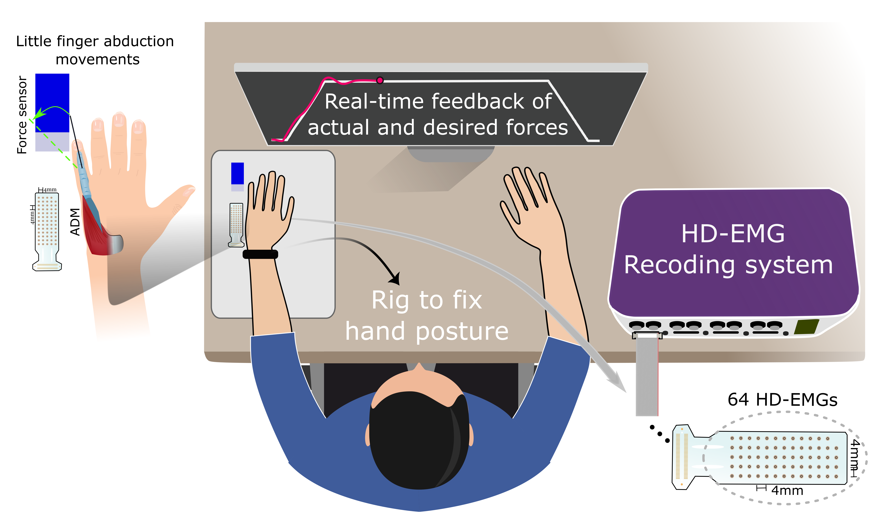
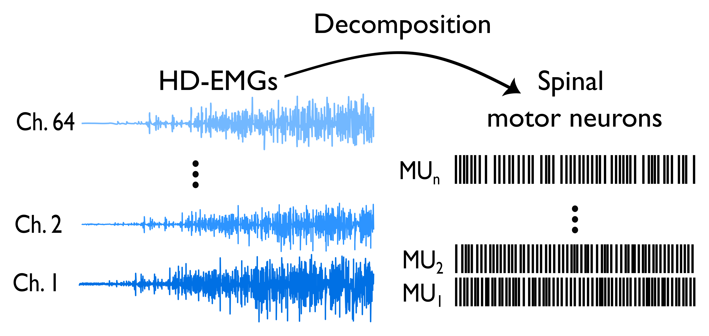

# The effects of high-PAS on corticospinal tract plasticity and motor unit discharge behavior

This repository accompanies the manuscript of the same title. The analysis code will be added here once the paper is published.

## Authors

Anna Nätkynmäki1,2, Mansour Taleshi3,4, Erika Kirveskari1,5, Janne Avela2, Ivan Vujaklija3, Anastasia Shulga1,\*

1. BioMag Laboratory, HUS Diagnostic Centre, Helsinki University Hospital, University of Helsinki and Aalto University School of Science, Helsinki, Finland
2. Faculty of Sport and Health Sciences, Neuromuscular Research Centre, University of Jyväskylä, Jyväskylä, Finland
3. Department of Electrical Engineering and Automation, Aalto University, Espoo, Finland
4. Faculty of Sport and Health Sciences, Gerontology Research Center, University of Jyväskylä, Jyväskylä, Finland
5. Clinical Neurophysiology, Clinical Neurosciences, HUS Medical Imaging Centre, Helsinki University Hospital and University of Helsinki, Helsinki, Finland

\* Corresponding author: Anastasia Shulga

## About the study

High-PAS is a modified paired associative stimulation (PAS) protocol that combines high-intensity transcranial magnetic stimulation (TMS) with high-frequency peripheral nerve stimulation (PNS). It has been shown to enhance corticospinal excitability in healthy individuals and to improve upper- and lower-limb motor function in people with incomplete spinal cord injury. The neurophysiological mechanisms behind these effects are not yet fully understood.

This randomized crossover study investigated the effects of high-PAS on corticospinal excitability and motor unit discharge behavior in twelve healthy volunteers. Each participant completed four sessions in randomized order, with a different 20-minute intervention in each:

| Session  | TMS    | PNS    |
| -------- | ------ | ------ |
| High-PAS | active | active |
| PNS-only | sham   | active |
| TMS-only | active | sham   |
| Sitting  | sham   | sham   |

High-density surface electromyography (HDsEMG) was recorded from the left abductor digiti minimi muscle. Motor evoked potentials, motor performance, and decomposed motor unit spike trains were assessed before the intervention, immediately after it, and 30 and 60 minutes later.

**Keywords:** paired associative stimulation, spinal cord injury, rehabilitation, high-density surface electromyography

## TMS and motor evoked potentials

Corticospinal excitability was assessed with 30 consecutive TMS pulses at 120% of the resting motor threshold over the abductor digiti minimi hotspot, delivered 3.3 s apart. Each pulse is one trial, and the motor evoked potentials (MEPs) were recorded on the 64-channel HDsEMG grid. For each participant, the median MEP peak-to-peak amplitude was then calculated for each channel.

  

  

MEPs vary from pulse to pulse, both in size and in where on the grid the largest response appears. The animation steps through 30 consecutive pulses from one participant: each cell is one channel, shaded by its MEP peak-to-peak amplitude in µV, and the blue box marks the largest response of each pulse.

## Motor task

Participants performed an isometric little-finger abduction task (HOLD) with the left hand fixed in a rig and the little finger against a force sensor. The target force followed a trapezoidal profile, with its level set from each participant's maximal voluntary contraction (MVC), and the actual and target forces were shown as real-time visual feedback. HDsEMG was recorded from the abductor digiti minimi with a 64-electrode grid (4 mm inter-electrode distance).

## Motor unit decomposition

After quality control, the HDsEMG signals recorded during the motor task were decomposed into motor unit spike trains using convolutive blind source separation. The estimated number of detected motor units, their mean discharge rate (MDR), and the coefficient of variation of the interspike intervals (CoV-ISI) were summarized from the motor units detected independently at each assessment.

## Code availability

The analysis code will be made available in this repository following publication of the paper. No code, datasets, or analysis files are included at this stage.

## Citation

Citation details will be added here once the paper is published.
